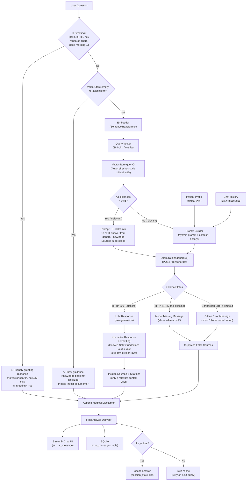
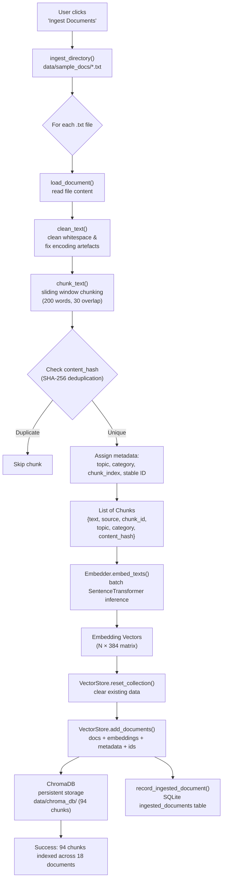
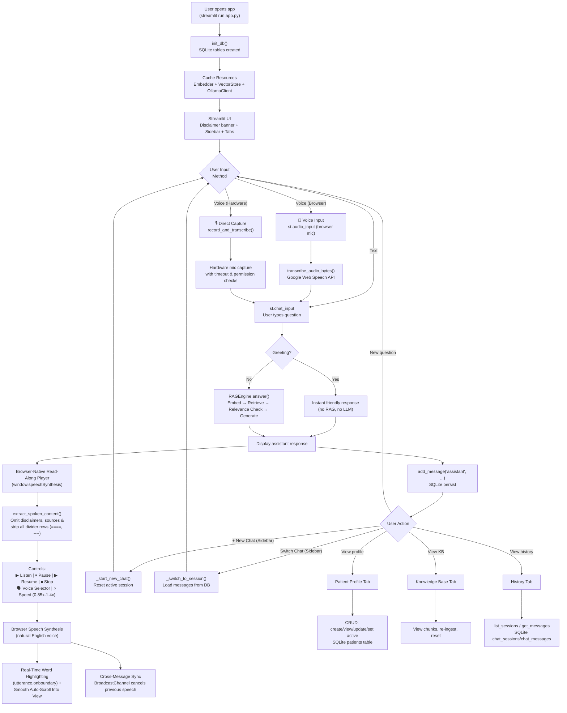
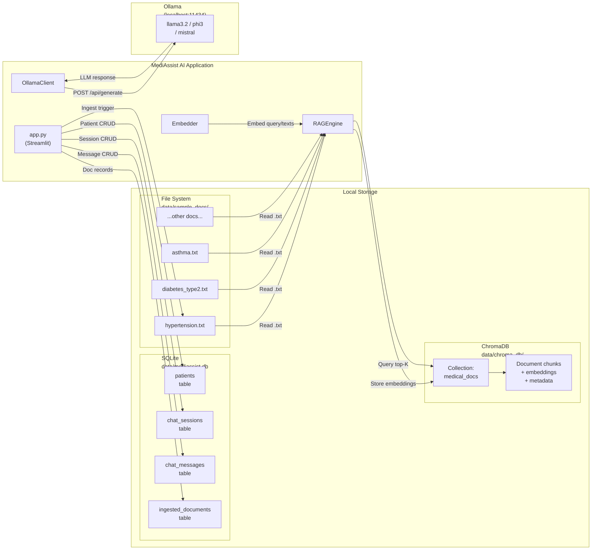

# MediAssist AI – System Flow Diagrams

This document contains Mermaid diagrams describing the key data flows and processes in MediAssist AI.

---

## 1. RAG Pipeline Flow

> **Updated (v1.0.6):** Added greeting normalization for repeated letters (e.g. "HII", "heyy"), self-healing VectorStore reconnection on stale collection IDs, and uninitialized/empty KB guidance.

---

## 2. Document Ingestion Flow

> **Updated (v1.0.5):** Reduced chunk size to 200 words (30 overlap), added SHA-256 content-hash deduplication, deterministic chunk IDs, and topic/category metadata tagging.

---

## 3. User Interaction Flow

> **Updated (v1.0.8):** Upgraded to browser-native Web Speech API (`speechSynthesis`) read-along player with real-time word highlighting, auto-scroll, voice & speed selectors, and zero audio file generation.

---

## 4. Data Storage Flow

